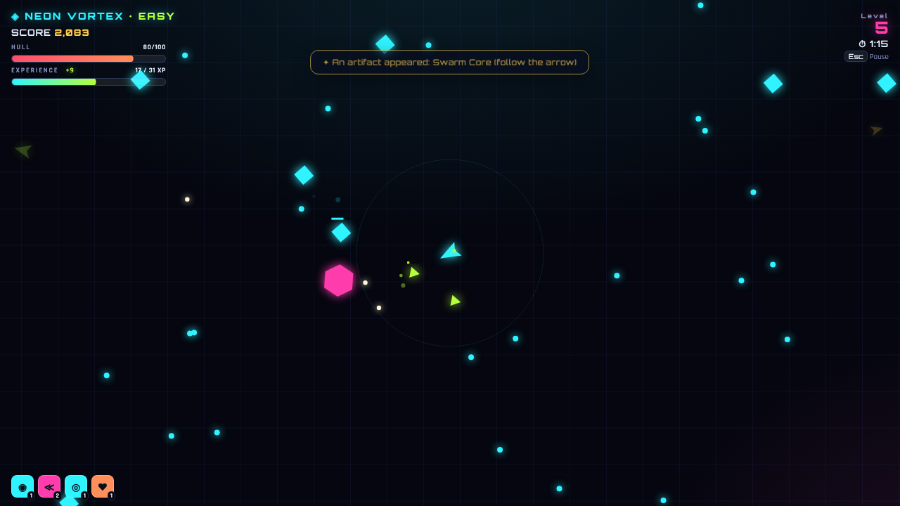
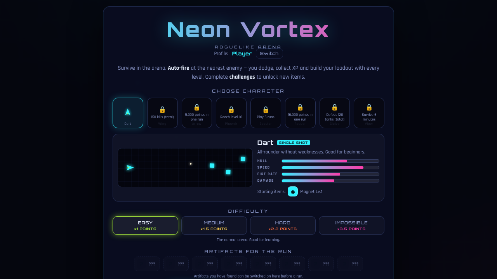

# ◈ Neon Vortex

Ein **Roguelike-Arena-Survival** im Neon-Look für den Browser. Du fliegst durch eine Arena, schießt automatisch auf die nächste Bedrohung und baust bei jedem Level-Up deinen Build aus Fähigkeiten. Challenges schalten neue Items und Charaktere frei. Es ist eine einzige HTML-Datei, die ohne Installation in jedem modernen Browser läuft.

**▶ Jetzt spielen:** https://marcopolo234231.github.io/neonvortex/

Das Spiel gibt es auf **Deutsch und Englisch**. Die Sprache richtet sich nach dem Browser und lässt sich im Menü mit 🌐 umschalten.

<b>🇬🇧 English</b>

**Neon Vortex** is a neon **roguelike arena survival** game for the browser. You fly through an arena, your ship auto-fires at the nearest threat, and every level-up lets you grow your build. Challenges unlock new items and characters. It is a single HTML file that runs in any modern browser without installation.

**▶ Play now:** https://marcopolo234231.github.io/neonvortex/ (the game switches to English automatically, or use the 🌐 button in the menu)

| Key | Action |
|-----|--------|
| `W` `A` `S` `D` / arrow keys | Move |
| *(automatic)* | Fires at the nearest enemy |
| `1` – `4` | Pick an upgrade on level-up |
| `R` | Reroll the upgrade choice |
| `Esc` | Pause (continue, journal, end run) |
| `Enter` / `Space` | Play again after dying |

- **8 characters**, each with its own weapon (twin shot, piercing lance, fireball, homing shots, shotgun, boomerang, triple burst)
- **51 items** (common, rare, epic, legendary), 40 of them unlocked through challenges
- **4 difficulties** from Easy to Impossible, with legendary items only on the harder ones
- **8 artifacts** that appear in the arena and can be switched on before each run
- Optional **own server** (Raspberry Pi) for accounts and cloud saves, see [server/ANLEITUNG.md](server/ANLEITUNG.md) (German)

---

## 🎮 Steuerung

| Taste | Aktion |
|-------|--------|
| `W` `A` `S` `D` / Pfeiltasten | Bewegen |
| *(automatisch)* | Schießt auf den nächsten Gegner |
| `1` – `4` | Upgrade beim Level-Up wählen |
| `R` | Upgrade-Auswahl neu würfeln |
| `Esc` | Pause (Weiter, Journal, Lauf beenden) |
| `Enter` / `Leertaste` | Nach dem Tod direkt nochmal spielen |

Beim Wechsel in einen anderen Tab pausiert das Spiel automatisch.

## 🛸 Charaktere

Jeder Charakter hat eigene Werte, eine eigene Schussart und startet mit Items auf Level 1. Im Menü zeigt eine **Schussvorschau**, wie er schießt. Auch gesperrte Charaktere kann man dort ansehen.

| Charakter | Schussart | Hülle | Start-Items | Freischaltung |
|---|---|---|---|---|
| Dart | Einzelschuss | 100 | Magnet | von Anfang an |
| Wing | Doppelschuss | 80 | Schub | 150 Kills (gesamt) |
| Arrow | Durchschlag-Lanze | 90 | Präzision | 5 000 Punkte in einem Lauf |
| Phoenix | Feuerball mit Flächenschaden | 110 | Brandmunition | Level 10 erreichen |
| Specter | Suchgeschoss | 70 | Weisheit, Glück | 6 Läufe spielen |
| Reaper | Schrotflinte | 140 | Schildplatten, Lebensraub | 16 000 Punkte in einem Lauf |
| Glaive | Bumerang (trifft hin und zurück) | 105 | Großkaliber | 120 Tanks (gesamt) |
| Viper | Dreier-Salve | 85 | Schnellfeuer | 6 Minuten überleben |

## ✨ Items & Level-Ups

- **51 Items** mit Seltenheit (Common, Rare, Epic), stapelbar bis zu ihrem Max-Level
- 11 Items sind von Anfang an verfügbar, **40 weitere** schaltest du über Challenges frei
- Jedes Level-Up gibt zusätzlich **+15 % Hülle** und **+3 % Schaden**
- Solange du noch keine Flächenwaffe hast, ist die **Schockwelle** bei jedem Level-Up garantiert
- Kein Item kann über sein Max-Level steigen. Beim letzten Level steht **MAX** dran
- Beispiele: Abpraller, Strahlungsfeld, Splitterkern, Kettenblitz, Orbital-Klingen, Drohne, Meteorschauer, Minenleger, Explosiv, Deflektor, Vollstrecker

## 🔥 Schwierigkeiten

| Stufe | Gegner | Punkte |
|---|---|---|
| Einfach | normale Werte | ×1 |
| Mittel | +50 % HP, +35 % Schaden, mehr Gegner | ×1.5 |
| Schwer | +120 % HP, +80 % Schaden, schneller | ×2.2 |
| Unmöglich | +220 % HP, +150 % Schaden, keine Heilung ausserhalb vom Kampf | ×3.5 |

7 **legendäre Items** kannst du nur auf Mittel, Schwer oder Unmöglich freischalten, zum Beispiel Laserstrahl, Singularität, Supernova und Quantenkopie. Einmal freigeschaltet, kannst du sie auf jeder Stufe benutzen.

## 💎 Pickups & Artefakte

**Auf dem Boden** liegen Drops von Gegnern: Reparaturkit, Bombe (räumt den Bildschirm frei) und Magnet (zieht alle XP-Orbs an). Etwa jede Minute taucht eine **Upgrade-Kiste** mit einem Gratis-Upgrade auf.

**Artefakte** erscheinen alle 2 bis 3 Minuten irgendwo in der Arena. Ein Pfeil am Bildschirmrand zeigt, wo sie liegen. Wie bei Risk of Rain kannst du jedes **gefundene Artefakt im Hauptmenü vor dem Lauf an- oder ausschalten**. Aktive Artefakte wirken dann ab der ersten Sekunde.

| Artefakt | Wirkung |
|---|---|
| ☠ Fluchschädel | Schwieriger: Gegner haben mehr HP und spawnen schneller. Dafür gibt es +75 % XP und +50 % Punkte |
| ✧ Wunschkristall | Solange aktiv: Bei jeder Item-Wahl ist jedes freigeschaltete Item wählbar (mit Suche und Sortierung) |
| ♛ Krone der Wahl | Level-Ups bieten 4 statt 3 Items |
| ❦ Phönixfeder | Einmal wiederbeleben mit 50 % Hülle |
| ⌛ Zeitsplitter | Alle Gegner 15 % langsamer |
| ◇ Glaskanone | Doppelter Schaden, aber nur halbe Hülle |
| ⁂ Schwarmkern | Viel mehr Gegner mit 40 % weniger HP |
| ♜ Elitesiegel | Tanks von Anfang an und doppelt so oft, dafür +40 % XP |

## 🍓 Eigener Server (Raspberry Pi)

Im Ordner `server/` liegt ein kleiner Server ohne Abhängigkeiten (nur Node.js). Er liefert das Spiel aus und speichert **Konten und Spielstände**: Konto erstellen, anmelden, kein doppelter Name, Passwörter gehasht. Läuft das Spiel über den Server, zeigt es Login und Registrieren statt der lokalen Profile. Das geht auch mit der Version auf GitHub Pages: Server-Adresse in `config.json` eintragen (z. B. über Tailscale Funnel). Anleitung: [server/ANLEITUNG.md](server/ANLEITUNG.md)

## 📖 Journal & Fortschritt

- Das **Journal** zeigt alle Items, Charaktere und Artefakte. Was noch nicht freigeschaltet ist, ist geschwärzt und zeigt die passende Challenge.
- Freischaltungen erscheinen nach dem Lauf mit einer Animation.
- **Profile:** Mehrere Spieler können eigene Profile anlegen. Der Fortschritt wird lokal im Browser gespeichert und nicht zwischen Geräten synchronisiert.

## 🛠️ Technik

- Reines **HTML5 Canvas** und JavaScript, keine Frameworks
- Schriften von Google Fonts (Orbitron, Rajdhani)
- Zweisprachig (Deutsch/Englisch): Deutsch steht im Code, die englischen Texte im Wörterbuch `TR` und in den `*_EN`-Tabellen in `game.src.html`
- Gehostet über **GitHub Pages**: Jeder Push auf `main` wird per GitHub Actions automatisch veröffentlicht (`.github/workflows/deploy.yml`)
- `game.src.html` ist der Quellcode, `index.html` die daraus erzeugte Seite für GitHub Pages

## 📦 Selbst ausführen

1. Repo klonen oder `index.html` herunterladen
2. Datei im Browser öffnen, fertig

## 🔖 Versionen

Feste Meilensteine stehen unter [Releases](https://github.com/Marcopolo234231/neonvortex/releases).

- **v1.0**: Charaktere mit Schussarten, 32 Items, Challenges, Journal, Artefakte und Pickups

---

*Gebaut von [Marcopolo234231](https://github.com/Marcopolo234231) mit [Claude Code](https://claude.com/claude-code).*
